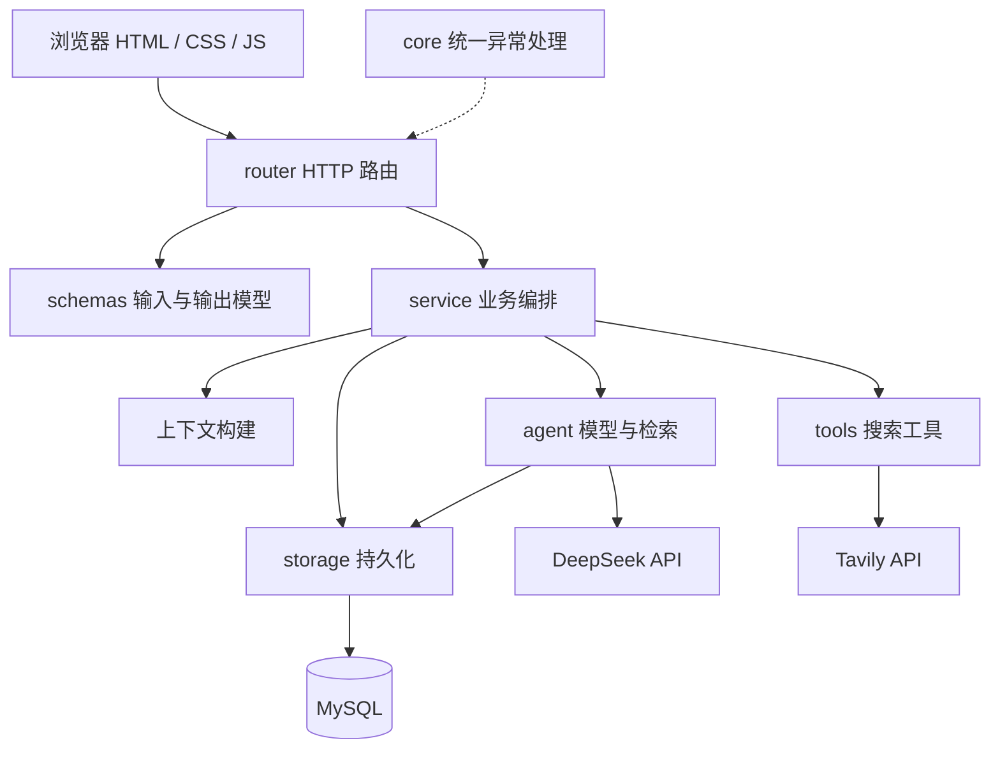
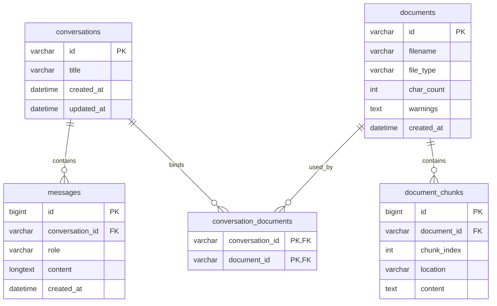
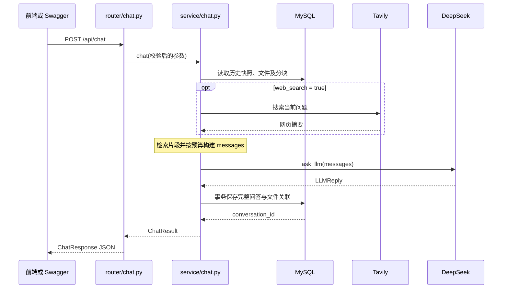

# 企业智能助手开发文档

本文基于 2026-10-25 项目代码整理，说明当前实现、每个源码文件的职责、技术选型、运行方式和扩展入口。页面品牌为“知序”，FastAPI 应用名称为“智能助手”。代码变更后，应同步更新本文对应章节。

## 目录

- [1. 项目概览](#1-项目概览)
- [2. 技术栈](#2-技术栈)
- [3. 目录结构与分层](#3-目录结构与分层)
- [4. 每个文件的代码作用](#4-每个文件的代码作用)
- [5. 本地环境与启动](#5-本地环境与启动)
- [6. 数据库设计](#6-数据库设计)
- [7. 聊天调用流程](#7-聊天调用流程)
- [8. 会话记忆与上下文](#8-会话记忆与上下文)
- [9. 文件上传与检索](#9-文件上传与检索)
- [10. 联网搜索](#10-联网搜索)
- [11. API 接口说明](#11-api-接口说明)
- [12. 前端实现](#12-前端实现)
- [13. 异常与状态码](#13-异常与状态码)
- [14. 手动验证与排查](#14-手动验证与排查)
- [15. 常见开发修改入口](#15-常见开发修改入口)
- [16. 当前限制与部署注意事项](#16-当前限制与部署注意事项)

## 1. 项目概览

项目提供带网页界面的聊天服务。用户可以直接向模型提问，也可以上传文件，或开启联网搜索，让模型参考相关资料回答。

当前能力：

| 能力 | 实现方式 |
| --- | --- |
| 普通聊天 | 调用 DeepSeek 兼容 OpenAI 的 Chat Completions API |
| 流式回答 | 后端返回 SSE，网页逐段追加模型正文 |
| 多轮会话 | MySQL 持久化问答，后续通过 `conversation_id` 恢复最近历史 |
| 会话管理 | 创建、列出、读取、删除会话 |
| 文件问答 | 提取 TXT、MD、PDF、DOCX 文字，分块存储并做关键词检索 |
| 联网搜索 | 用户开启开关后，通过 Tavily 搜索当前问题 |
| 引用展示 | 网页显示搜索来源与实际进入上下文的文件片段 |
| 输入与异常管理 | Pydantic 校验、统一业务异常、统一 HTTP 状态码 |
| 开发调试 | FastAPI 自动生成 Swagger 和 OpenAPI |

当前执行顺序由程序固定：读取记忆 → 检索文件 → 按需搜索 → 组装上下文 → 调用模型 → 保存问答。`agent/` 是模型与检索模块目录；项目尚未实现模型自主选择工具、反复执行工具的 Agent 循环，也没有单独处理或展示模型的 `reasoning_content`。

## 2. 技术栈

| 技术 / 依赖 | 用途 | 当前使用情况 |
| --- | --- | --- |
| Python | 后端语言 | 代码使用 `str \| None` 等语法，语言层面至少需要 Python 3.10；依赖兼容性仍需单独验证 |
| FastAPI | Web 框架 | 路由、依赖参数解析、响应模型、Swagger、静态文件服务 |
| Uvicorn | ASGI 服务 | 本地运行和开发自动重载 |
| Pydantic v2 | 数据结构与校验 | `BaseModel`、`ConfigDict`、`model_validator` 等；由 FastAPI 依赖引入 |
| `openai` | 模型客户端 | 使用 `AsyncOpenAI` 连接 DeepSeek，支持普通和流式请求 |
| DeepSeek | 大语言模型 | 默认模型 `deepseek-chat`，接口地址和模型可配置 |
| `python-dotenv` | 配置加载 | 从根目录 `.env` 读取配置 |
| MySQL / InnoDB | 持久化存储 | 会话、消息、文档元数据、分块、会话文档关联 |
| `pymysql` | 数据库驱动 | 参数化 SQL、字典游标、显式事务 |
| Tavily REST API | 网页搜索 | 使用 Python 标准库 `urllib` 请求搜索接口 |
| `tavily-python` | 搜索 SDK 依赖 | 已列入依赖文件，当前搜索代码没有导入它 |
| `python-multipart` | 上传解析 | 支持 `multipart/form-data` 文件上传 |
| `pypdf` | PDF 解析 | 读取文字层、页码、加密状态 |
| `python-docx>=1.1.0` | DOCX 解析 | 按文档顺序读取段落和表格 |
| HTML / CSS / 原生 JavaScript | 前端 | 无 React、Vue 或 Node.js 构建步骤 |
| Fetch / ReadableStream / TextDecoder | 浏览器网络能力 | 请求接口、增量解析 UTF-8 SSE、取消请求 |
| localStorage | 浏览器缓存 | 缓存会话列表、消息及部分展示信息 |

本地现有虚拟环境使用 Python 3.15.0，这只是当前环境快照，不代表项目已对所有 Python 版本完成兼容验证。依赖以 [requirements.txt](requirements.txt) 为准，大部分依赖尚未锁定版本。

## 3. 目录结构与分层

```text
ai-agent/
├── main.py                    # 应用入口
├── requirements.txt           # Python 依赖
├── agent_db.sql               # 五张业务表的统一初始化脚本
├── README.md                  # 快速使用说明
├── DEVELOPMENT.md             # 本开发文档
├── .env                       # 本地配置，包含密钥，不提交版本库
├── .gitignore                 # Git 忽略规则
├── agent/
│   ├── __init__.py
│   ├── llm.py                 # 模型调用
│   ├── prompts.py             # 系统提示词
│   └── rag.py                 # 文件片段检索
├── core/
│   ├── __init__.py
│   ├── exceptions.py          # 业务异常定义
│   └── exception_handlers.py  # 异常映射与全局处理器
├── router/
│   ├── __init__.py
│   ├── chat.py                # 聊天与 SSE 接口
│   ├── conversations.py       # 会话管理接口
│   ├── files.py               # 文件上传与查询接口
│   └── search.py              # 独立搜索接口
├── schemas/
│   ├── __init__.py
│   ├── chat.py
│   ├── conversation.py
│   ├── error.py
│   ├── files.py
│   └── search.py
├── service/
│   ├── __init__.py
│   ├── chat.py                # 聊天业务编排
│   ├── context.py             # 上下文预算与消息构建
│   ├── files.py               # 文件解析与分块
│   └── memory.py              # 异步会话记忆适配层
├── storage/
│   ├── __init__.py
│   ├── mysql.py               # 连接、事务、会话与消息存储
│   └── documents.py           # 文档与分块存储
├── tools/
│   ├── __init__.py
│   └── web_search.py          # Tavily REST 客户端
├── static/
│   ├── index.html             # 页面结构
│   ├── styles.css             # 页面样式
│   ├── app.js                 # 页面交互
│   └── favicon.svg            # 网站图标
└── skills/                    # 预留目录，当前未接入运行流程
```

`.venv/` 是依赖环境；`__pycache__/` 是 Python 缓存；`.idea/` 是编辑器配置；`.tmp/` 是临时文件目录；`.git/` 是版本库元数据。这些目录不承载项目业务逻辑。



路由层负责 HTTP；服务层协调业务；模型与工具层调用外部能力；存储层处理 SQL；数据模型描述接口契约。多数文件遵循此划分，部分简单查询路由会直接调用存储层。

## 4. 每个文件的代码作用

### 4.1 根目录文件

| 文件 | 代码 / 内容作用 | 阅读或修改时关注 |
| --- | --- | --- |
| [main.py](main.py) | 创建 FastAPI 应用；注册异常处理器和四组路由；挂载 `/static`；返回首页和 `/health`；直接执行时启动 Uvicorn | 新增路由需要在此注册；默认监听 `127.0.0.1:8000` |
| [requirements.txt](requirements.txt) | 声明运行依赖 | 新能力需要新依赖时更新；目前只给 `python-docx` 指定了最低版本 |
| [agent_db.sql](agent_db.sql) | 创建会话、消息、文档、分块、关联五张表 | 是当前唯一统一建表入口；没有 `storage/schema.sql` |
| [README.md](README.md) | 安装、启动、接口及页面的快速使用说明 | 适合首次运行项目时阅读 |
| [DEVELOPMENT.md](DEVELOPMENT.md) | 代码结构、模块职责、调用流程与扩展说明 | 随实际代码维护 |
| `.env` | 保存模型、搜索、MySQL 连接配置 | 仅说明配置项，不在文档中复制真实密钥 |
| [.gitignore](.gitignore) | 忽略 `.env`、`.venv/`、`.idea/`、`__pycache__/`、`*.py[cod]`、`.pytest_cache/`、`.tmp/` | `.gitignore` 不会自动移除已被 Git 跟踪的文件 |

### 4.2 `agent/`：模型与检索

| 文件 | 关键代码 | 职责与实现细节 |
| --- | --- | --- |
| [agent/__init__.py](agent/__init__.py) | 包初始化文件 | 标识 `agent` 包，不承担聊天业务 |
| [agent/llm.py](agent/llm.py) | `LLMReply`、`_client_settings()`、`_usage_dict()`、`ask_llm()`、`stream_llm()` | 读取 DeepSeek 配置，封装返回结构和 Token 用量；普通调用返回完整结果，流式调用先产出正文字符串，最后产出 `LLMReply` |
| [agent/prompts.py](agent/prompts.py) | `SYSTEM_PROMPT` | 集中维护助手角色、处理任务、证据使用和输出要求；提示词描述能力不等于代码已经实现能力 |
| [agent/rag.py](agent/rag.py) | `_tokens()`、`retrieve()`、`retrieve_documents()` | 合并文件范围、加载分块、按英文词与中文相邻双字评分，选取参考片段；概览或无匹配时按文件轮流取开头片段 |

`agent/llm.py` 每次调用使用异步上下文管理器创建和关闭客户端；请求超时设为 60 秒，最多重试一次，输出上限 `max_tokens=2048`。空正文会转换为 `LLMResponseError`。流式实现接收 `stop` 或 `length` 结束原因，并通过 `include_usage` 尝试读取用量；因此达到输出上限的回答也可能正常保存。代码只处理正文，不处理独立思考字段。

### 4.3 `core/`：异常与全局处理

| 文件 | 关键代码 | 职责与实现细节 |
| --- | --- | --- |
| [core/__init__.py](core/__init__.py) | 包初始化文件 | 标识 `core` 包 |
| [core/exceptions.py](core/exceptions.py) | 各类业务异常 | 定义模型、搜索、数据库、会话、上下文、文件错误类型；业务层抛出异常，不需要知道 HTTP 状态码 |
| [core/exception_handlers.py](core/exception_handlers.py) | `ErrorSpec`、`ERROR_SPECS`、`ERROR_RESPONSES`、`resolve_exception()`、`handle_exception()`、`register_exception_handlers()` | 将异常类型统一转换为状态码和中文提示；生成 Swagger 错误响应说明；注册全局处理器；流式错误也复用这份映射 |

映射按异常类的继承关系查找，使超时、认证等具体错误优先于通用父类。日志记录请求方法、路径、异常类型和状态码，不直接输出上游原始报文。FastAPI 自带的参数校验错误与 HTTP 异常保持框架默认格式。

### 4.4 `router/`：HTTP 接口

| 文件 | 关键代码 | 职责与实现细节 |
| --- | --- | --- |
| [router/__init__.py](router/__init__.py) | 包初始化文件 | 标识 `router` 包 |
| [router/chat.py](router/chat.py) | `_chat_arguments()`、`create_chat()`、`_event()`、`create_chat_stream()` | 把 Pydantic 请求转换为服务层参数；普通聊天返回 `ChatResponse`；流式聊天先准备上下文，再返回 `StreamingResponse`；异常转为 SSE `error` 事件 |
| [router/conversations.py](router/conversations.py) | 创建、列表、详情、删除四个处理函数 | 接收 UUID、分页数量与标题，调用 MySQL 存储；同步 `def` 路由由 FastAPI 放入线程池运行 |
| [router/files.py](router/files.py) | `upload_file()`、`get_file()` | 接收字段名为 `file` 的上传；最多主动读取 10 MiB 加 1 字节以判断超限；无论成功失败都关闭 `UploadFile`；异步查询文件元数据 |
| [router/search.py](router/search.py) | `create_search()` | 提供独立搜索接口，直接返回 Tavily 结果，不调用语言模型 |

**当前需要留意的实际配置：** `router/chat.py` 的 `_chat_arguments()` 仍为每个请求传入固定摘要“用户正在开发企业知识库 Agent，目前已完成聊天和联网搜索。”，以及中文、简洁回答的固定偏好。这些内容是示例上下文，并非从用户历史自动生成；`ChatRequest` 也没有开放 `summary` 或 `preferences` 字段。需要自定义时，从这里和服务层接口开始调整。

### 4.5 `schemas/`：请求与响应结构

| 文件 | 关键模型 | 职责与实现细节 |
| --- | --- | --- |
| [schemas/__init__.py](schemas/__init__.py) | 包初始化文件 | 标识 `schemas` 包 |
| [schemas/chat.py](schemas/chat.py) | `MessageText`、`HistoryMessage`、`ChatRequest`、`TokenUsage`、`ChatResponse` | 校验聊天文本、历史角色、UUID、文件数量、搜索开关及总长度；定义回答和引用结构 |
| [schemas/conversation.py](schemas/conversation.py) | `ConversationCreate`、`ConversationCreated`、`ConversationSummary`、`StoredMessage`、`ConversationDetail` | 定义会话创建、摘要、消息和详情；详情包含 `files` |
| [schemas/error.py](schemas/error.py) | `ErrorResponse` | 定义统一业务错误格式 `detail: str` |
| [schemas/files.py](schemas/files.py) | `DocumentInfo`、`DocumentSource` | 定义上传解析信息及参考片段，包含文件名、片段编号、位置等 |
| [schemas/search.py](schemas/search.py) | `SearchRequest`、`SearchResult`、`SearchResponse` | 校验搜索词和结果数量；定义标题、链接、摘要的返回结构 |

聊天、历史消息、搜索和会话创建请求禁止额外字段。历史导入只允许 `user`、`assistant`；客户端不能通过该结构注入 `system` 消息。`web_search` 使用严格布尔值，搜索结果数量使用严格整数。

### 4.6 `service/`：业务编排

| 文件 | 关键代码 | 职责与实现细节 |
| --- | --- | --- |
| [service/__init__.py](service/__init__.py) | 包初始化文件 | 标识 `service` 包 |
| [service/chat.py](service/chat.py) | `ChatResult`、`PreparedChat`、`prepare_chat()`、`chat()`、`stream_chat()` | 串联记忆、文件检索、搜索、上下文、模型、保存；普通与流式共用准备流程；仅报告实际保留的文件引用 |
| [service/context.py](service/context.py) | `_group_history()`、`_prepare_references()`、`_build_current_message()`、`build_context()` | 按预算组装系统提示、完整历史轮次、当前问题、摘要、偏好、搜索结果和文件片段 |
| [service/files.py](service/files.py) | `_decode_text()`、`_read_pdf()`、`_read_docx()`、`_split_sections()`、`parse_file()`、`ingest_file()` | 校验文件类型与大小，解析文字，保留位置，切块并调用文档存储；耗时解析与同步 SQL 通过线程执行 |
| [service/memory.py](service/memory.py) | `MemoryContext`、`load_context()`、`trim_context()`、`save_turn()` | 将异步聊天流程适配到同步 MySQL 操作，携带历史快照和最后消息 ID；提交整轮问答 |

`PreparedChat` 保存模型输入、记忆快照、搜索来源、全部关联文件 ID 和本次保留的文件片段。`service/chat.py` 通过片段的 JSON 表达是否仍出现在最终当前消息中，筛选 `document_sources`。

`service/memory.py` 的 `trim_context()` 保留了旧的历史裁剪工具，但当前聊天主流程实际调用的是 `service/context.py` 的 `build_context()`。调整主要上下文策略应修改后者。

### 4.7 `storage/`：数据库访问

| 文件 | 关键代码 | 职责与实现细节 |
| --- | --- | --- |
| [storage/__init__.py](storage/__init__.py) | 包初始化文件 | 标识 `storage` 包 |
| [storage/mysql.py](storage/mysql.py) | `_setting()`、`get_connection()`、`_transaction()` | 读取配置、创建 PyMySQL 连接、统一提交 / 回滚 / 关闭连接 |
| 同上 | `_require_conversation()`、`_last_message_id()`、`create_conversation()`、`save_message()` | 校验会话存在，可对会话行加锁；提供创建会话与单条保存能力 |
| 同上 | `load_memory()`、`get_history()`、`save_turn()` | 读取最近历史与版本；事务内保存整轮问答、初始历史和文件关联，检查并发冲突 |
| 同上 | `list_conversations()`、`get_conversation()`、`delete_conversation()` | 会话列表、详情与删除；删除时先删除消息，再删除会话 |
| 同上 | `initialize_schema()`、命令行 `--init` | 从根目录读取 `agent_db.sql`，执行缺失表初始化 |
| [storage/documents.py](storage/documents.py) | `save_document()`、`get_document()` | 原子保存文档元数据与分块；读取时计算分块数、首块预览并解码 JSON 警告 |
| 同上 | `resolve_document_ids()`、`list_conversation_documents()`、`get_document_chunks()` | 合并请求文件与会话已绑定文件，去重、校验存在和数量，查询关联信息及分块 |

数据库采用 `DictCursor` 和 `utf8mb4`；连接、读、写超时分别为 5、10、10 秒，`autocommit=False`。每次存储操作独立创建和关闭连接，目前没有连接池。SQL 值使用参数传递；动态 `IN` 条件只拼接占位符。

### 4.8 `tools/`：外部搜索

| 文件 | 关键代码 | 职责与实现细节 |
| --- | --- | --- |
| [tools/__init__.py](tools/__init__.py) | 包初始化文件 | 标识 `tools` 包 |
| [tools/web_search.py](tools/web_search.py) | `_search()`、`web_search()` | 请求 Tavily，限制响应大小，校验返回字段和 URL，裁剪摘要；将网络和上游状态转换为搜索异常 |

`_search()` 是同步 HTTP 请求；`web_search()` 校验参数与密钥后，通过 `asyncio.to_thread()` 调用它，避免阻塞异步事件循环。

### 4.9 `static/`：前端

| 文件 | 关键结构 / 函数 | 职责与实现细节 |
| --- | --- | --- |
| [static/index.html](static/index.html) | 侧栏、欢迎区、消息区、聊天表单、文件输入、图标符号 | 定义页面 DOM、无障碍标签及操作入口；上传由输入框内部的 `+` 按钮触发隐藏文件选择框 |
| [static/styles.css](static/styles.css) | 布局、消息、输入框、附件、引用、响应式规则 | 暖色浅色页面；适配桌面和手机；处理流式光标、侧栏、代码块、减少动态效果偏好等 |
| [static/app.js](static/app.js) | `state`、`restore()`、`persist()`、`loadSession()`、`syncConversations()` | 管理当前会话、缓存与服务端同步，恢复服务端 ID 和附件绑定 |
| 同上 | `uploadFiles()`、`renderAttachments()`、`stagedFiles()` | 上传文件、显示待发送附件、移除本轮选择；已绑定附件内部保留但不显示卡片 |
| 同上 | `submit()`、`readEvents()`、`contextFor()` | 清空输入、发起流式请求、解析事件、逐段显示回答；兼容旧浏览器会话历史导入 |
| 同上 | `markdown()`、`inline()`、`messageView()`、`renderSources()`、`safeURL()` | 构建消息、基础 Markdown 和引用 DOM；检查链接协议，避免把模型正文当原始 HTML 插入 |
| 同上 | `updateInput()`、`startNew()`、`checkConnection()`、`copy()`、`showError()` | 输入状态、新建会话、存活检查、复制、错误与重试交互 |
| [static/favicon.svg](static/favicon.svg) | SVG 图形 | 网站标签页图标 |

## 5. 本地环境与启动

以下命令均在项目根目录、Windows PowerShell 中执行。

### 5.1 安装依赖

如果尚无虚拟环境，使用已安装且与依赖兼容的 Python 创建：

```powershell
python -m venv .venv
```

已有 `.venv` 时无需重复创建。安装项目依赖：

```powershell
.\.venv\Scripts\python.exe -m pip install -r requirements.txt
```

### 5.2 配置环境变量

在根目录创建或维护 `.env`。下面只有占位内容，需要替换为自己的配置：

```dotenv
DEEPSEEK_API_KEY=replace_with_your_deepseek_key
DEEPSEEK_BASE_URL=https://api.deepseek.com
DEEPSEEK_MODEL=deepseek-chat
TAVILY_API_KEY=replace_with_your_tavily_key
MYSQL_HOST=127.0.0.1
MYSQL_PORT=3306
MYSQL_USER=agent_user
MYSQL_PASSWORD=replace_with_your_mysql_password
MYSQL_DATABASE=agent_db
```

| 配置 | 默认值 / 要求 |
| --- | --- |
| `DEEPSEEK_API_KEY` | 无默认值；调用模型必填 |
| `DEEPSEEK_BASE_URL` | 默认 `https://api.deepseek.com` |
| `DEEPSEEK_MODEL` | 默认 `deepseek-chat` |
| `TAVILY_API_KEY` | 无默认值；只有搜索接口或开启联网搜索时需要 |
| `MYSQL_HOST` | 默认 `127.0.0.1` |
| `MYSQL_PORT` | 默认 `3306`，必须为 1–65535 的整数 |
| `MYSQL_USER` | 默认 `agent_user` |
| `MYSQL_PASSWORD` | 默认空字符串 |
| `MYSQL_DATABASE` | 默认 `agent_db` |

数据库配置兼容 `DB_HOST`、`DB_PORT`、`DB_USER`、`DB_PASSWORD`、`DB_NAME`。对应的 `MYSQL_*` 存在时优先使用，包括显式设置为空字符串的情况。操作系统中已有环境变量默认优先于 `.env`。

`.env` 按代码所在位置解析到项目根目录；修改配置后重启服务。当前没有 `.env.example` 文件，配置模板以本文和 README 为参考。

### 5.3 初始化数据库

先通过 MySQL 管理工具创建数据库，并配置可访问它的账号。例如数据库字符集采用：

```sql
CREATE DATABASE IF NOT EXISTS agent_db
DEFAULT CHARACTER SET utf8mb4
COLLATE utf8mb4_unicode_ci;
```

随后执行项目初始化命令：

```powershell
.\.venv\Scripts\python.exe -m storage.mysql --init
```

此命令读取 [agent_db.sql](agent_db.sql)，使用已配置账号连接已存在的数据库。它只创建缺失表，不创建数据库或账号，也不会升级现有表结构。MySQL DDL 可能隐式提交，不能将整个初始化过程视为可整体回滚的数据迁移。

### 5.4 启动应用

```powershell
.\.venv\Scripts\python.exe main.py
```

开发时可改用自动重载：

```powershell
.\.venv\Scripts\python.exe -m uvicorn main:app --reload
```

| 地址 | 用途 |
| --- | --- |
| `http://127.0.0.1:8000/` | 聊天网页 |
| `http://127.0.0.1:8000/docs` | Swagger 手动调用接口 |
| `http://127.0.0.1:8000/openapi.json` | OpenAPI 结构 |
| `http://127.0.0.1:8000/health` | 应用存活检查，返回 `{"status":"ok"}` |

`/health` 不验证 MySQL、DeepSeek 或 Tavily 是否可用。前端由 FastAPI 同源提供，无需单独启动前端工程。

## 6. 数据库设计

五张表均使用 InnoDB、`utf8mb4` 和 `utf8mb4_unicode_ci`。会话与文档主键由 Python 生成 UUID 字符串，消息与分块主键由 MySQL 自增。



### 6.1 字段与约束

| 表 | 字段说明 | 索引和约束 |
| --- | --- | --- |
| `conversations` | `id VARCHAR(36)`；`title VARCHAR(200)` 默认“新对话”；创建和更新时间为 `DATETIME` | `id` 主键；`updated_at` 支持自动更新，业务保存问答时也显式更新 |
| `messages` | `id BIGINT` 自增；`conversation_id VARCHAR(36)`；`role VARCHAR(20)`；`content LONGTEXT`；`created_at DATETIME` | 主键 `id`；组合索引 `(conversation_id, created_at, id)`；会话外键删除策略为 `RESTRICT` |
| `documents` | `id VARCHAR(36)`；`filename VARCHAR(255)`；`file_type VARCHAR(16)`；`char_count INT UNSIGNED`；`warnings TEXT`；创建时间 | 主键 `id`；`warnings` 保存 JSON 数组文本，数据库类型不是 JSON |
| `document_chunks` | 自增 `id`；`document_id VARCHAR(36)`；`chunk_index INT UNSIGNED` 从 1 开始；`location VARCHAR(100)`；`content TEXT` | 唯一约束 `(document_id, chunk_index)`；删除文档时分块级联删除 |
| `conversation_documents` | `conversation_id` 和 `document_id`，均为 `VARCHAR(36)` | 两列构成联合主键；删除会话或文档时关联行级联删除 |

### 6.2 原子保存与并发控制

聊天生成期间不保持数据库事务和连接。开始时读取会话历史及 `last_message_id`；模型完成后，再打开短事务提交：

1. 新会话在该事务内创建，标题取当前问题前 200 字符。
2. 已有会话通过 `SELECT ... FOR UPDATE` 锁定会话行。
3. 比较当前最后消息 ID 与准备阶段快照；不一致则抛出 `ConversationConflictError`，返回 409。
4. 合并并校验文件关联数量和文件存在性，追加新关联。
5. 新会话需要导入的初始历史、当前问题、助手回答一起写入。
6. 更新会话时间并提交；出错则回滚。

这避免一轮聊天只保存用户问题或只保存半段回答。并发检查发生在生成完成后，因此冲突请求仍可能已经消耗模型调用资源。

### 6.3 删除与数据保留

删除会话时，程序先删除 `messages`，再删除 `conversations`，关联行由外键级联删除。文档及分块会继续保留，因为同一文档可以关联多个会话。

数据库目前保存消息角色和原文，不保存每轮模型名称、Token 用量、网页来源、文件引用结果。这些额外展示信息主要来自当前响应和浏览器缓存。

## 7. 聊天调用流程

### 7.1 普通聊天



数据库保存的是用户原始问题，不会把附加网页摘要或文件片段伪装成用户消息存入历史。

### 7.2 流式聊天

`POST /api/chat/stream` 和普通聊天使用相同的请求结构。路由先完成记忆读取、检索、搜索和上下文构建；这些步骤失败时仍可以返回正常 HTTP 错误状态。

开始流式响应后：

1. `sources`：发送网页来源和实际保留的文件参考片段。
2. `delta`：逐段发送模型正文。
3. 收到模型完成结果后，提交完整问答和文件关联。
4. 提交成功才发送 `done`，内容为完整 `ChatResponse`。
5. 生成或保存出错时发送 `error`，包含逻辑状态码和错误提示。

服务端使用 `aclosing()` 和 SDK 上下文管理器关闭生成器、模型流与客户端，并在接收模型块时检查浏览器是否断开。取消请求不保证撤销已经开始的搜索线程或数据库提交；若在提交附近停止，应重新加载会话确认状态。

SSE 本身是单向事件流，本项目使用 `fetch` 发起 POST 并读取响应流，没有使用仅方便 GET 的浏览器 `EventSource`。

## 8. 会话记忆与上下文

### 8.1 三种会话输入方式

| 请求方式 | 行为 |
| --- | --- |
| 仅传 `message` | 模型成功回答后自动创建会话，并返回 ID |
| 传 `message` 和 `history` | 视为新会话，使用并在成功时导入提供的历史 |
| 传 `message` 和 `conversation_id` | 读取该会话最近历史；此时不允许再传非空 `history` |

服务端默认读取最近 20 条 `user` / `assistant` 消息，按消息 ID 倒序取出后恢复正序。数据库保留完整历史，但较早消息不会自动进入每次模型请求。

### 8.2 校验上限与实际模型预算

| 控制项 | 当前值 | 位置 |
| --- | --- | --- |
| 单条问题 / 导入历史文本长度 | 去除首尾空白后 1–8000 字符 | `schemas/chat.py` |
| 请求携带历史条数 | 最多 40 条 | `schemas/chat.py` |
| 请求问题与历史合计 | 最多 60000 字符 | `ChatRequest.validate_context()` |
| 实际模型输入正文总预算 | 6000 字符 | `service/context.py: MAX_INPUT_CHARS` |
| 最多保留的历史消息 | 20 条，且需完整轮次和预算允许 | `MAX_HISTORY_MESSAGES` |
| 摘要 | 初始最多 3000 字符 | `MAX_SUMMARY_CHARS` |
| 网页参考 | 初始最多 5 条，每条摘要最多 2000 字符，标题最多 200 字符 | `_prepare_references()` |
| 用户偏好 | 最多 5 项；键最多 40、值最多 300 字符 | `build_context()` |

60000 是 API 接收上限；6000 是当前上下文构建的预算。它们含义不同。实际输入预算只累计消息 `content` 的 Python 字符数，**不是模型 Token 数**，也不包含协议包装的全部开销。

因此，一条不足 8000 字符、通过 Pydantic 的问题，仍可能因加上系统提示超过 6000 字符而返回 400。

### 8.3 组装顺序与裁剪策略

最终 `messages` 大致为：

```text
system：系统提示词 + 本次能力说明 + 参考资料使用约束
user / assistant：最近能放下的完整历史轮次
user：当前问题 + JSON 形式的摘要、偏好、网页结果、文件片段
```

`build_context()` 先确认“系统提示 + 原始问题”可以放下，再构造当前用户消息。若资料超预算，依次移除较后的网页结果、文件片段，随后反复减半摘要，最后移除偏好项。仍然超限则返回上下文错误。

剩余空间用于历史：从最新完整轮次往前选择；遇到条数或字符预算不足就停止，不拆开一轮问答，再恢复正序。

系统消息声明资料仅供参考、不能执行文件或搜索结果内的指令，并区分本次是否真的执行过搜索。此约束依靠提示词和数据分隔，仍不能保证模型完全遵守。

### 8.4 当前记忆的边界

目前实现的是“数据库持久化 + 最近历史窗口”。没有自动摘要生成、长期事实抽取、用户偏好表、跨会话记忆检索。路由内固定摘要与偏好只是传入 `build_context()` 的示例数据，不会随着聊天自动更新。

## 9. 文件上传与检索

### 9.1 从上传到问答


上传本身不调用语言模型，也不会立即将文档绑定某个会话。首次带 `file_ids` 的聊天成功保存时才建立关联；后续只传 `conversation_id` 就能继续使用已绑定文件。新传入的文件是追加关系，不替换已有附件。

### 9.2 支持格式

| 格式 | 解析方式 | 位置与注意事项 |
| --- | --- | --- |
| TXT / MD | UTF-16 BOM 检测；否则依次尝试 UTF-8（允许 BOM）、GB18030 | 位置为“正文”；纯文本路径检查 NUL 字符，异常内容可能被拒绝 |
| PDF | `pypdf.PdfReader` 提取各页文字 | 保留“第 N 页”；无文字页记入警告，不做 OCR；加密时仅尝试空密码解密 |
| DOCX | 读取 ZIP 结构后，通过 `iter_inner_content()` 按顺序提取段落与表格 | 表格单元格使用 ` | ` 连接；位置为“正文”；没有排版渲染，因此不提供推测页码 |

图片、扫描件 OCR、旧版 DOC、Excel 尚未实现。PDF 全部提取不到文字会返回错误；混合 PDF 可保留有文字页面，并返回其他页面的警告。

### 9.3 限制与分块

| 项目 | 当前限制 |
| --- | --- |
| 单文件上传 | 10 MiB，即 `10 * 1024 * 1024` 字节 |
| PDF 页数 | 200 页 |
| 提取正文 | 200000 字符 |
| 分块数量 | 400 块 |
| 分块大小 | 约 1000 字符，优先在块后半段的换行处切分 |
| 相邻块重叠 | 150 字符 |
| DOCX ZIP 条目 | 最多 2000 个 |
| DOCX 声明的解压总大小 | 最多 50 MiB |
| 每会话文件 | 请求文件与已绑定文件合并去重后最多 5 个 |
| 文件名 | 去除路径信息，最多保留 255 字符并尽量保留扩展名 |

当前上传接口在读取业务内容后限制大小；multipart 解析可能已将上传数据放入临时缓冲。部署时如需限制整个请求体，还应在反向代理或服务器层配置。

### 9.4 检索算法

`agent/rag.py` 是轻量词法检索：

1. 英文、数字、下划线按词提取并转小写。
2. 连续中文拆成相邻双字，例如“知识库”得到“知识”“识库”。
3. 为问题词计算分块词频和逆文档频率式权重，词频贡献最多取 3，并按块长度归一。
4. 一般问题按分数选择最多 4 块；概览 / 总结问题或完全无匹配时，按文件轮流选择开头块。
5. 每块正文只保留前 700 字符，进入整体上下文预算后还可能被剔除。

这不是向量语义检索，也不是完整标准 BM25。当前会读取所选文件的全部分块再在内存评分。命中内容若出现在块的后部，截取前 700 字符可能丢失相关句子；大文件的“总结”也只覆盖少量片段，不能当作全文总结。

返回的 `document_sources` 表示本次实际进入模型上下文的片段，包含 `file_id`、`filename`、`chunk_index`、`location`、`content`。它不证明模型逐项引用或核实过所有片段。

### 9.5 文件存储与生命周期

长期保存的是提取后的文字、分块和元数据，原始上传文件不会长期落盘归档。当前没有文件下载、删除、解绑接口或无引用文档清理任务。移除待发送附件只是取消本轮选择，不会删除已经上传的文档记录。

## 10. 联网搜索

`tools/web_search.py` 向 `https://api.tavily.com/search` 发送 JSON POST，使用服务端 `TAVILY_API_KEY` 作为 Bearer 凭证。

| 行为 | 当前值 |
| --- | --- |
| 搜索深度 | `basic` |
| 独立搜索词长度 | 去除首尾空白后 1–400 字符 |
| 独立搜索结果数量 | 默认 5，范围 1–10 |
| 聊天使用的搜索词 | 当前问题前 400 字符，不自动结合历史改写 |
| 聊天结果数量 | 最多 5 条 |
| 返回单条摘要 | 最多 3000 字符，进入上下文时进一步限制为 2000 |
| 请求超时 | 15 秒 |
| 最大响应读取 | 2 MiB，超出报错 |
| Tavily 参数 | `include_answer=false`、`include_raw_content=false` |

结果必须包含可用的 HTTP / HTTPS URL；程序提取 `title`、`url`、`content`。401 / 403 转换为认证错误，429 / 432 / 433 转换为额度或限流错误，408 / 504 转换为超时。

不开启联网时不要求 Tavily 密钥。开启后搜索失败会返回错误，不会静默假装已经搜索成功。`sources` 是本次检索结果，可能多于最终上下文实际保留的网页资料，也不代表模型引用了每一条结果。

## 11. API 接口说明

完整字段和即时校验规则可在运行中的 `/docs`、`/openapi.json` 查看。

### 11.1 接口总览

| 方法 | 路径 | 正常状态 | 用途 |
| --- | --- | --- | --- |
| GET | `/` | 200 | 聊天页面 |
| GET | `/static/{path}` | 200 | 静态资源 |
| GET | `/health` | 200 | 应用存活检查 |
| GET | `/docs` | 200 | Swagger 文档页面 |
| GET | `/openapi.json` | 200 | OpenAPI 定义 |
| POST | `/api/chat` | 200 | 完整 JSON 聊天响应 |
| POST | `/api/chat/stream` | 200 | SSE 流式聊天 |
| POST | `/api/search` | 200 | 独立联网搜索 |
| POST | `/api/files` | 201 | 上传并解析文件 |
| GET | `/api/files/{file_id}` | 200 | 查询文件解析信息 |
| POST | `/api/conversations` | 201 | 创建空会话 |
| GET | `/api/conversations` | 200 | 列出最近会话 |
| GET | `/api/conversations/{conversation_id}` | 200 | 读取会话、消息和文件 |
| DELETE | `/api/conversations/{conversation_id}` | 204 | 删除会话，无响应体 |

### 11.2 普通聊天

首次请求：

```http
POST /api/chat
Content-Type: application/json
```

```json
{
  "message": "我正在开发企业知识库，请给我三个下一步建议。",
  "history": [],
  "web_search": false,
  "file_ids": []
}
```

响应示意如下，文本、ID、模型和用量以真实返回为准：

```json
{
  "conversation_id": "11111111-1111-4111-8111-111111111111",
  "reply": "可以先完善文档解析、改进检索，再增加用户权限。",
  "model": "deepseek-chat",
  "usage": {
    "prompt_tokens": 600,
    "completion_tokens": 80,
    "total_tokens": 680
  },
  "sources": [],
  "document_sources": []
}
```

`usage` 在上游不提供时可以是 `null`。继续提问必须复制实际返回的 ID，下面 UUID 只是示意：

```json
{
  "conversation_id": "11111111-1111-4111-8111-111111111111",
  "message": "把第一个建议拆成可执行步骤。"
}
```

开启搜索时增加 `"web_search": true`；首次使用文件时增加上传接口返回的 `file_ids`。请求体不能包含 `summary`、`preferences` 等未声明字段。

### 11.3 SSE 格式

每个事件由事件名、一行 JSON 数据和空行组成：

```text
event: sources
data: {"sources":[],"document_sources":[]}

event: delta
data: {"text":"你好"}

event: delta
data: {"text":"，有什么可以帮你？"}

event: done
data: {"conversation_id":"11111111-1111-4111-8111-111111111111","reply":"你好，有什么可以帮你？","model":"deepseek-chat","usage":null,"sources":[],"document_sources":[]}

```

发生流内错误时可能收到：

```text
event: error
data: {"status":504,"detail":"模型响应超时，请稍后重试。"}

```

响应头发出后 HTTP 状态保持 200，客户端必须检查 `error` 事件，不能只看 `response.ok`。只有收到 `done` 才能认定这一轮完成并保存成功。

PowerShell 可用以下命令观察事件；`--data-binary` 直接使用简短英文请求，避免不同终端的中文编码差异：

```powershell
curl.exe -N -X POST http://127.0.0.1:8000/api/chat/stream -H 'Content-Type: application/json' --data-binary '{"message":"Hello"}'
```

旧版 Windows PowerShell 对原生命令引号的处理可能不同；若参数传递异常，使用网页观察流式回答，或在 HTTP 客户端中发送相同 JSON。Swagger 更适合验证普通聊天的完整响应。

### 11.4 上传与文件问答

上传使用 `multipart/form-data`，字段名是 `file`，一次 API 调用接收一个文件。前端多选时逐个调用。

```powershell
curl.exe -X POST http://127.0.0.1:8000/api/files -F "file=@C:/documents/handbook.pdf"
```

将路径替换成真实文件。返回示意：

```json
{
  "file_id": "22222222-2222-4222-8222-222222222222",
  "filename": "handbook.pdf",
  "file_type": "pdf",
  "char_count": 5000,
  "chunk_count": 6,
  "preview": "第一段文字……",
  "warnings": [],
  "created_at": "2026-10-25T12:00:00"
}
```

带实际 `file_id` 提问：

```json
{
  "message": "文件中规定的年假如何申请？",
  "file_ids": ["22222222-2222-4222-8222-222222222222"]
}
```

`GET /api/files/{file_id}` 返回相同的元数据结构。聊天响应的 `document_sources` 示例：

```json
{
  "file_id": "22222222-2222-4222-8222-222222222222",
  "filename": "handbook.pdf",
  "chunk_index": 2,
  "location": "第 3 页",
  "content": "员工申请年假时……"
}
```

### 11.5 独立搜索

```http
POST /api/search
Content-Type: application/json
```

```json
{
  "query": "Python 官方最新稳定版本",
  "max_results": 5
}
```

返回 `{"query":"...","results":[{"title":"...","url":"https://...","content":"..."}]}`。无匹配结果时 `results` 可为空数组，此接口不创建会话。

### 11.6 会话管理

| 操作 | 参数 / 响应 |
| --- | --- |
| 创建 | `POST /api/conversations`，请求 `{"title":"研发讨论"}`；返回 `{"conversation_id":"实际 UUID"}`；标题默认“新对话”，长度 1–200 |
| 列表 | `GET /api/conversations?limit=20`；`limit` 范围 1–100；按更新时间倒序返回 `id`、`title`、创建和更新时间 |
| 详情 | `GET /api/conversations/{id}?limit=80`；`limit` 范围 1–100；返回基本信息、最近消息正序数组 `messages`、关联文件数组 `files` |
| 删除 | `DELETE /api/conversations/{id}`；成功 204，不返回 JSON |

消息详情包含 `id`、`role`、`content`、`created_at`；存储结构允许 `user`、`assistant`、`system`、`tool`，但聊天记忆输入只使用前两类。

## 12. 前端实现

### 12.1 页面与交互

前端为原生单页面交互，通过同源相对路径访问 API。页面包括会话侧栏、欢迎建议、消息列表、输入框、联网开关、上传入口、发送 / 停止按钮、错误提示和引用卡片。

输入框内的 `+` 按钮触发隐藏文件输入，没有单独前端上传页面。响应式样式包含 1150、768、380 像素附近的布局调整，手机端侧栏使用遮罩开关。

发送时输入框立即清空。失败后的问题单独保存在重试状态，不会自动重新填回输入框。Enter 发送、Shift + Enter 换行；Ctrl / Cmd + K 新建会话，手机侧栏可通过遮罩或 Escape 关闭。

### 12.2 会话与附件状态

`state` 管理会话、当前 ID、搜索开关、进行中的请求、加载、预览、上传和新会话附件。需要区分三个 ID / 数据概念：

| 状态 | 含义 |
| --- | --- |
| 前端会话 `id` | 页面和本地缓存定位会话使用 |
| `conversationId` | 服务端 MySQL 会话 UUID；成功收到 `done` 后保存 |
| `stagedFiles` / `newFiles` | 上传完成但尚待本轮提交的附件 |
| 会话 `files` | 服务端已经绑定的附件，继续用于检索但不展示“已关联”卡片 |

上传成功只代表文件已经解析入库；聊天成功才把待发送附件转为会话绑定文件。请求失败时可以保留待发送文件重试。

### 12.3 流解析与渲染

`readEvents()` 使用 `TextDecoder` 以流模式处理 UTF-8，保留跨网络块的不完整文本和事件，避免中文多字节字符截断。`delta` 到来时先更新纯文本，利用 `requestAnimationFrame` 合并页面刷新，并显示流式光标；完成后再渲染 Markdown 和来源。

停止或异常时，已显示的部分回答可以保留在当前页面预览，但不会作为成功问答写入浏览器正式消息历史。服务端也需要模型完成并成功提交才能返回 `done`。

Markdown 渲染器支持常用标题、列表、引用、表格、代码块和链接等，是自定义基础实现，不是完整 CommonMark。通过 DOM 节点和文本内容构建展示，不直接执行模型返回的 HTML；链接协议检查限制为 HTTP / HTTPS。

### 12.4 缓存和超时

| 项目 | 当前行为 |
| --- | --- |
| localStorage 键 | `zhixu.conversations.v1` |
| 会话列表 | 页面获取最近 20 段会话，本地缓存也限制约 20 段 |
| 消息显示 | 服务端详情默认最近 80 条；恢复本地缓存时保留最近 80 条 |
| 普通 JSON 请求 | 浏览器超时 20 秒 |
| 文件上传 | 浏览器超时 90 秒 |
| 流式聊天 | 浏览器整体超时 150 秒 |
| `/health` 检查 | 浏览器超时 5 秒 |

MySQL 是会话原文的持久化来源，localStorage 用于缓存和补充模型、来源等展示信息。清理浏览器缓存后，已入库消息仍可恢复，但部分额外元数据可能丢失。

## 13. 异常与状态码

异常类型集中在 [core/exceptions.py](core/exceptions.py)，状态码与对外文案集中在 [core/exception_handlers.py](core/exception_handlers.py)。

| 状态码 | 对应异常 / 场景 | 处理方向 |
| --- | --- | --- |
| 400 | `ContextTooLargeError`、`FileParseError`、`FileTextUnavailableError`、`DocumentLimitError` | 缩短问题、检查文件内容、先做 OCR 或减少关联文件 |
| 404 | `ConversationNotFoundError`、`DocumentNotFoundError` | 检查实际 ID，重新加载或上传 |
| 409 | `ConversationConflictError` | 重新读取会话后再提交，避免同时向同一会话发问 |
| 413 | `FileTooLargeError` | 检查上传大小、页数、正文、分块或 DOCX 解压规模 |
| 415 | `UnsupportedFileError` | 使用 TXT、MD、PDF、DOCX |
| 422 | FastAPI / Pydantic 输入校验 | 检查类型、必填项、UUID、文本长度和额外字段 |
| 429 | 模型 `RateLimitError`、`SearchRateLimitError` | 检查账户额度和调用频率 |
| 500 | 未匹配到具体规则的 `Exception` | 服务端排查未知错误 |
| 502 | 模型认证 / 连接 / API / 空响应异常；搜索认证或一般搜索错误 | 检查上游服务、接口地址、网络和密钥 |
| 503 | `LLMConfigError`、`SearchConfigError`、`DatabaseConfigError`、`MySQLError` | 检查 `.env`、MySQL 连接、权限、表结构与认证依赖 |
| 504 | 模型 `APITimeoutError`、`SearchTimeoutError` | 稍后重试或排查网络与上游耗时 |

普通业务错误为：

```json
{
  "detail": "会话不存在或已删除，请开启新对话。"
}
```

422 保持 FastAPI 默认结构，`detail` 是字段错误列表。流开始后的错误使用 `event: error`，数据为 `{"status":502,"detail":"..."}`；HTTP 状态已经确定，不能再改。

新增业务错误时，应增加异常类、添加 `ERROR_SPECS` 映射，并在业务层抛出。使用 `ERROR_RESPONSES` 的路由会自动获得相应 Swagger 状态码说明。

## 14. 手动验证与排查

项目按当前使用方式通过 Swagger 和网页手动验证，不包含自动化测试目录。修改功能后，可按下面顺序检查。

### 14.1 Swagger 与网页验证清单

| 检查项 | 操作 | 预期 |
| --- | --- | --- |
| 应用存活 | `GET /health` | 返回 `status=ok` |
| 普通聊天 | `POST /api/chat` 仅传一个问题 | 返回回复、模型、会话 ID |
| 多轮记忆 | 先告知名字，再携带实际会话 ID 问名字 | 模型能参考最近历史 |
| 会话隔离 | 新会话询问另一个会话刚提供的信息 | 请求上下文不会自动包含另一会话历史 |
| 会话管理 | 创建、列出、读取、删除后再读取 | 创建 201、删除 204、删除后读取 404 |
| 输入校验 | 空白问题、非法 UUID、额外字段、ID 与非空历史同时传入 | 返回 422 |
| 搜索 | 先独立调用 `/api/search`，再聊天开启搜索 | 返回搜索结果并显示来源 |
| 文件解析 | 分别上传 TXT、MD、文字 PDF、含表格 DOCX | 返回解析信息、片段数和预览 |
| 文件问答 | 上传后带 `file_ids` 提问，再仅用会话 ID 追问 | 可继续使用绑定文件 |
| 无效文件 | 空文件、损坏 PDF、不支持后缀、超过限制 | 返回对应 400 / 413 / 415 |
| 扫描 PDF | 上传无文字层 PDF | 明确未提取到文字，不伪造 OCR 结果 |
| 流式交互 | 网页发送、停止、出错重试 | 输入立即清空，文字逐段显示，完成后渲染 Markdown |
| 附件显示 | 上传、发送成功、刷新或切换会话 | 待发送卡片可见，已绑定卡片隐藏，后续仍能检索 |
| 并发冲突 | 两个请求基于同一历史快照生成并先后提交 | 后提交的冲突请求返回 409 或流内 `error` |

模型是否正确回忆是行为验证，还应结合会话详情确认消息确实保存。不要把 `/health` 成功当作模型与数据库已经连通。

### 14.2 常见问题

| 现象 | 优先检查 |
| --- | --- |
| 启动报模块不存在 | 是否用 `.venv` 中的 Python 安装并运行；依赖是否装全 |
| 上传路由启动报 multipart 相关错误 | `python-multipart` 是否安装 |
| 503 数据库错误 | MySQL 是否启动；数据库与账号是否存在；密码、端口、权限、五张表是否正确 |
| 新增文档表外键创建失败 | 已有表字符集、排序规则与 UUID 字段类型是否一致 |
| 初始化后旧表字段没有变化 | `CREATE TABLE IF NOT EXISTS` 不修改旧表，需要单独迁移 |
| 502 模型认证错误 | DeepSeek 密钥是否有效，是否被系统环境变量中的旧值覆盖 |
| 429 | 模型或 Tavily 额度、速率限制 |
| 504 | 网络、代理、上游耗时；模型 60 秒与搜索 15 秒超时配置 |
| 通过输入校验却返回 400 上下文过长 | 6000 字符实际预算还包含系统消息，和 8000 / 60000 API 上限不同 |
| 文件上传成功但回答找不到内容 | 问题词是否匹配、目标页是否有文字、检索片段是否截断或被预算剔除 |
| 大文件总结不完整 | 当前只选最多 4 个片段，尚未做全文分段汇总 |
| 流式回答最后一次性出现 | 使用的是否为 `/api/chat/stream`；代理或 HTTP 客户端是否缓冲 SSE |
| 已看到回答但最后报错 | 可能是模型流结束异常、数据库提交失败或并发冲突；没有 `done` 就不能认定保存成功 |
| 刷新后来源信息减少 | 来源和用量没有随每轮消息完整保存到数据库 |

## 15. 常见开发修改入口

| 开发需求 | 修改入口 | 配套考虑 |
| --- | --- | --- |
| 修改角色和回答风格 | `agent/prompts.py`；`router/chat.py` 固定偏好 | 能力描述应与实际工具一致 |
| 替换默认模型 | `.env` 的 `DEEPSEEK_MODEL` / `DEEPSEEK_BASE_URL` | 新模型需兼容当前 Chat Completions 和流式 usage；不同思考字段需要额外适配 |
| 调整输出长度、超时、重试 | `agent/llm.py` | 同步考虑前端 150 秒整体超时 |
| 调整历史和上下文 | `service/context.py`；`storage/mysql.py: load_memory()` | 区分读取数量、选择数量、字符预算与真实 Token 预算 |
| 自动摘要 / 长期偏好 | 新增持久化结构和记忆服务，接入 `prepare_chat()` | 替换路由硬编码数据；设计摘要更新时机、失败处理和会话归属 |
| 新增文件格式 | `service/files.py`、`router/files.py`、`static/index.html`、`static/app.js` | 后端后缀、解析器、前端 accept 与校验、依赖、异常、文档一并更新 |
| 优化检索 | `agent/rag.py`；必要时扩展 `storage/documents.py` | 可加入更好的分词、BM25、向量、重排；需要索引更新和已有文档重建方案 |
| 全文总结 | 在文件服务和聊天编排中新增分段汇总 | 当前概览只抽取开头片段，应规划分段 → 汇总与预算 |
| 新增搜索参数 | `schemas/search.py`、`tools/web_search.py`、`service/chat.py` | 聊天搜索和独立搜索需共同考虑 |
| 新增工具或 Agent 循环 | `service/chat.py`、`agent/llm.py` 和新工具模块 | 需要实现工具协议、调度、迭代上限和结果回传，不能只加提示词 |
| 新增 HTTP 接口 | `schemas/` → `service/` / `storage/` → `router/` → `main.py` | 复用异常映射和接口模型 |
| 修改错误提示或状态码 | `core/exception_handlers.py` | 保持普通响应、Swagger、SSE 错误一致 |
| 修改表结构 | `agent_db.sql` 加上实际迁移步骤 | 更新初始化文件不能自动升级已经存在的表 |
| 调整页面布局 | `static/index.html`、`static/styles.css` | 注意桌面、手机、键盘操作和正在生成的状态 |
| 调整附件显示和发送行为 | `static/app.js` 的上传、提交和渲染函数 | 区分待发送与已绑定，避免隐藏卡片时丢失后台绑定 |
| 保存来源 / Token 信息 | 扩展 SQL 和存储，再更新响应与前端恢复 | 当前浏览器缓存无法替代服务端审计记录 |

## 16. 当前限制与部署注意事项

以下为代码现状，列出的扩展方向尚未实现：

| 范围 | 当前限制 | 后续方向 |
| --- | --- | --- |
| Agent | 固定流程，未实现自主工具调用循环或独立思考展示 | 明确工具协议、决策与执行循环，单独适配需要的模型能力 |
| 记忆 | 最近历史窗口，固定示例摘要和偏好 | 自动摘要、事实记忆、用户设置持久化 |
| 上下文 | 字符预算，非 Token 感知 | 根据模型 Token 估算分配预算，并验证输出预留 |
| 文件理解 | 文字提取与词法检索，片段范围有限 | OCR、向量检索、重排、全文汇总 |
| 文件管理 | 原文件不归档，无删除 / 解绑 / 清理接口 | 生命周期、原件存储、配额与清理任务 |
| 数据库 | 每操作建立连接，无连接池 | 根据并发量引入连接池和监控 |
| 用户隔离 | 没有登录、用户表或资源归属鉴权 | 用户认证，以及会话、文件访问授权 |
| 展示元数据 | 来源、模型和用量未完整随消息入库 | 扩展每轮消息或调用记录表 |
| 依赖与迁移 | 大部分依赖未锁版本；没有迁移框架 | 固定可复现版本，建立增量迁移流程 |

默认启动仅监听本机。当前 ID 隔离是按请求中的会话和文件 ID 查询，不等于多用户权限隔离；知道有效文件 ID 就可能将其用于自己的请求。部署到多人环境前，需要实现资源归属校验。

生产部署应使用独立配置和进程管理，关闭开发重载；如果经过 Nginx 等代理，需确保 SSE 不被缓存或缓冲，并配置合适的读取超时。应用已发送 `Cache-Control: no-cache` 和 `X-Accel-Buffering: no`，仍需确认代理实际生效。

模型、Tavily 和数据库密钥仅由服务端读取，不应写入静态文件或提交到仓库。日志和文档应继续避免复制真实配置。数据库备份至少应覆盖这五张表；文档原文件当前不在项目中长期保存。
